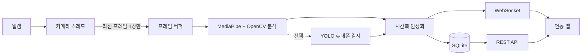

# GazeSignal API

> 웹캠 영상을 내 컴퓨터 안에서만 분석해, 시선 방향과 얼굴 상태를 REST와 WebSocket으로 알려 주는 API

GazeSignal API는 일반 웹캠으로 다음 신호를 실시간으로 만듭니다.

- 대략적인 시선 구역: 가운데, 왼쪽, 오른쪽, 위, 아래, 화면 밖, 판정 불가
- 얼굴이 화면에 있는지 여부
- 머리 방향: 좌우 회전, 위아래 기울기, 옆 기울기
- 눈 깜빡임
- 휴대폰이 보이는지 여부 (선택 기능)

원본 영상은 저장하지도, 내보내지도 않습니다. 밖으로 나가는 것은 위 신호를 담은 숫자와 상태값뿐입니다.
그래서 웹 서비스나 데스크톱 앱에 별도 서비스처럼 붙여 쓸 수 있습니다.

> **이 API가 하지 않는 일**
> 집중도, 감정, 정직성, 능력, 의도를 추론하지 않습니다. `looking_away`, `face_missing`,
> `phone_visible`은 카메라가 관찰한 사실일 뿐, 사람에 대한 판정이나 자동 결정의 근거가 아닙니다.
> 전문 적외선 아이트래커를 대신하지도 않습니다. 정확한 픽셀 좌표가 아니라 화면의 큰 구역만 추정합니다.

## 목차

- [지원 환경](#지원-환경)
- [설치와 실행: macOS](#설치와-실행-macos)
- [설치와 실행: Windows](#설치와-실행-windows)
- [처음 써 보기](#처음-써-보기)
- [API 사용 예](#api-사용-예)
- [설정](#설정)
- [휴대폰 감지 켜기](#휴대폰-감지-켜기)
- [동작 원리](#동작-원리)
- [개인정보 보호](#개인정보-보호)
- [테스트](#테스트)
- [알려진 한계](#알려진-한계)
- [활용 분야와 확장](#활용-분야와-확장)

## 지원 환경

| 항목 | 지원 | 비고 |
|---|---|---|
| macOS | Apple Silicon(M1 이상), macOS 13 이상 | 실제 MacBook 카메라로 검증함 |
| Windows | Windows 10/11 64비트 (x64) | 설치 파일은 제공되나 실기기 검증 전 |
| Python | 3.11 또는 3.12 | 3.13 이상은 아직 지원하지 않음 |
| Intel Mac, ARM Windows | 지원 안 됨 | MediaPipe가 해당 설치 파일을 제공하지 않음 |

모든 명령은 저장소 최상위 폴더에서 실행합니다. 모델 파일과 `.env`를 그 위치 기준으로 찾기 때문입니다.

## 설치와 실행: macOS

**1. Python 3.12 설치**

```bash
brew install python@3.12
```

Homebrew가 없다면 [python.org](https://www.python.org/downloads/macos/)에서 3.12 설치 파일을 받아도 됩니다.

**2. 코드 받기와 설치**

```bash
git clone https://github.com/100bee/gaze-signal-api.git
cd gaze-signal-api

python3.12 -m venv .venv
source .venv/bin/activate
pip install -e ".[dev,vision]"
python scripts/download_models.py
```

마지막 명령은 얼굴 랜드마크 모델을 `models/` 폴더에 내려받고 체크섬을 확인합니다.

**3. 서버 실행**

```bash
gaze-signal-api
```

브라우저에서 <http://127.0.0.1:8000> 을 열면 로컬 콘솔이 나옵니다.

**4. 카메라 권한**

처음 카메라를 켤 때 macOS가 권한을 묻습니다. 허용하지 않았다면
**시스템 설정 → 개인정보 보호 및 보안 → 카메라**에서 사용 중인 터미널 앱을 켜고, 터미널을 다시 실행하세요.

**5. 라이브 미리보기 (선택)**

카메라 화면 위에 분석 결과를 겹쳐 보여 주는 디버깅 창입니다. 영상은 저장하지 않습니다.

```bash
gaze-signal-preview --consent --camera 0
```

iPhone 연속성 카메라가 연결된 Mac에서는 내장 카메라가 1번일 수 있습니다. 화면이 검게 나오면 `--camera 1`로 다시 실행하세요.
`Q`나 `Esc`로 종료하고, `M`으로 좌우 반전을 바꿉니다.

## 설치와 실행: Windows

아래 명령은 PowerShell 기준입니다.

**1. Python 3.12 설치**

[python.org](https://www.python.org/downloads/windows/)에서 Windows installer (64-bit)를 받아 설치합니다.
설치 첫 화면에서 **Add python.exe to PATH**를 체크하세요. 설치 후 확인합니다.

```powershell
py -3.12 --version
```

**2. 코드 받기와 설치**

```powershell
git clone https://github.com/100bee/gaze-signal-api.git
cd gaze-signal-api

py -3.12 -m venv .venv
.\.venv\Scripts\Activate.ps1
pip install -e ".[dev,vision]"
python scripts\download_models.py
```

`Activate.ps1`이 실행 정책 오류로 막히면, 현재 창에서만 허용한 뒤 다시 실행합니다.

```powershell
Set-ExecutionPolicy -Scope Process -ExecutionPolicy Bypass
.\.venv\Scripts\Activate.ps1
```

**3. 서버 실행**

```powershell
gaze-signal-api
```

브라우저에서 <http://127.0.0.1:8000> 을 열면 로컬 콘솔이 나옵니다.

**4. 카메라 권한**

**설정 → 개인 정보 및 보안 → 카메라**에서 **카메라 액세스**와 **데스크톱 앱이 카메라에 액세스하도록 허용**을 모두 켜세요.
Zoom, Teams 같은 앱이 카메라를 쓰고 있으면 열리지 않으니 먼저 종료합니다.

**5. 라이브 미리보기 (선택)**

```powershell
gaze-signal-preview --consent --camera 0
```

외장 웹캠을 연결했다면 `--camera 1`일 수 있습니다.

## 처음 써 보기

서버를 켠 뒤 <http://127.0.0.1:8000> 콘솔에서 다음 순서로 진행합니다.

1. 카메라 분석 동의 체크박스를 선택하고 **시작**을 누릅니다.
2. 실시간 상태, 시선 구역, 머리 방향이 갱신되는지 확인합니다.
3. 시선 구역을 쓰려면 **캘리브레이션**을 실행합니다. 5점 또는 9점 표적을 차례로 바라보면 됩니다.
4. 캘리브레이션이 저장되면 **시작**을 다시 누릅니다. 같은 콘솔 화면에서 시작하는 세션은 이 보정값을 씁니다.
   페이지를 새로고침하면 콘솔은 보정값을 잊으므로 다시 캘리브레이션해야 합니다.

캘리브레이션 없이도 얼굴 부재와 머리를 크게 돌린 시선 이탈은 판정됩니다.
다만 눈동자 위치만으로 정하는 시선 구역은 정확도가 낮아서, 상태를 `unknown`으로 남겨 둡니다.

브라우저 탭을 닫으면 콘솔이 세션 중지를 보내 카메라가 꺼집니다.

상태 확인과 API 문서는 다음 주소에 있습니다.

| 주소 | 내용 |
|---|---|
| <http://127.0.0.1:8000/health> | DB, OpenCV, MediaPipe, 모델 파일 설치 상태 |
| <http://127.0.0.1:8000/docs> | 모든 API를 브라우저에서 직접 호출해 볼 수 있는 Swagger UI |

## API 사용 예

세션은 **생성 → 시작 → 중지 → 요약 조회 → 삭제** 순서로 씁니다.
세션을 만들기 전에, 통합하는 앱의 화면에서 카메라 사용 목적을 알리고 동의를 받아야 합니다.

**macOS 터미널 (bash, zsh)**

```bash
SESSION_ID=$(curl -s http://127.0.0.1:8000/sessions \
  -H 'content-type: application/json' \
  -d '{"consent_given": true, "camera_index": 0, "frame_width": 640, "frame_height": 480, "target_fps": 15}' \
  | python3 -c 'import json, sys; print(json.load(sys.stdin)["id"])')

curl -X POST "http://127.0.0.1:8000/sessions/$SESSION_ID/start"
curl "http://127.0.0.1:8000/sessions/$SESSION_ID/events?limit=100&offset=0"
curl -X POST "http://127.0.0.1:8000/sessions/$SESSION_ID/stop"
curl "http://127.0.0.1:8000/sessions/$SESSION_ID/summary"
curl -X DELETE "http://127.0.0.1:8000/sessions/$SESSION_ID"
```

`?`와 `&`가 들어간 주소는 꼭 따옴표로 감싸세요. zsh는 따옴표가 없으면 `no matches found` 오류를 냅니다.

**Windows PowerShell**

```powershell
$api = "http://127.0.0.1:8000"
$body = '{"consent_given": true, "camera_index": 0, "frame_width": 640, "frame_height": 480, "target_fps": 15}'
$session = Invoke-RestMethod -Method Post -Uri "$api/sessions" -ContentType "application/json" -Body $body

Invoke-RestMethod -Method Post -Uri "$api/sessions/$($session.id)/start"
Invoke-RestMethod "$api/sessions/$($session.id)/events?limit=100&offset=0"
Invoke-RestMethod -Method Post -Uri "$api/sessions/$($session.id)/stop"
Invoke-RestMethod "$api/sessions/$($session.id)/summary"
Invoke-RestMethod -Method Delete -Uri "$api/sessions/$($session.id)"
```

PowerShell의 `curl`은 실제 curl이 아니라 다른 명령의 별칭이라서 위 bash 예시가 그대로 동작하지 않습니다.

**실시간 이벤트**

세션이 실행 중일 때 다음 WebSocket에 연결하면 분석한 프레임마다 최신 이벤트를 받습니다.
받는 쪽이 느리면 오래된 이벤트는 건너뛰고 최신 것만 보냅니다.

```text
ws://127.0.0.1:8000/ws/sessions/{SESSION_ID}
```

```json
{
  "session_id": "8bf3de9a-f0d8-45c2-a719-07bcb8962fb4",
  "timestamp": "2026-09-04T01:23:45.123Z",
  "face_present": true,
  "face_analysis_available": true,
  "gaze_zone": "center",
  "gaze_feature_x": 0.51,
  "gaze_feature_y": 0.48,
  "head_yaw": -4.2,
  "head_pitch": 7.1,
  "head_roll": 0.8,
  "blink_detected": false,
  "phone_visible": false,
  "state": "screen_facing",
  "confidence": 0.87,
  "processing_latency_ms": 8.4
}
```

`state`는 다음 네 값 중 하나입니다.

| 값 | 뜻 |
|---|---|
| `screen_facing` | 화면 쪽을 보고 있음 |
| `looking_away` | 화면 밖을 1초 이상 보고 있음 |
| `face_missing` | 얼굴이 보이지 않음 |
| `unknown` | 판단할 근거가 부족함 |

`confidence`는 확률이 아닙니다. 모델 가용성, 특징 품질, 캘리브레이션 오차를 조합한 품질 기준값입니다.

더 많은 요청과 응답 예시는 [API 예시](docs/api_examples.md)에 있습니다.

## 설정

설정은 환경 변수나 저장소 최상위의 `.env` 파일로 바꿉니다. 예시 파일을 복사해서 시작하세요.

```bash
cp .env.example .env              # macOS
Copy-Item .env.example .env       # Windows PowerShell
```

자주 바꾸는 값은 다음과 같습니다. 모두 `GAZE_SIGNAL_`로 시작합니다.

| 변수 | 기본값 | 설명 |
|---|---|---|
| `GAZE_SIGNAL_HOST` | `127.0.0.1` | 서버 주소. 바꾸지 않는 것을 권장 |
| `GAZE_SIGNAL_PORT` | `8000` | 서버 포트 |
| `GAZE_SIGNAL_ALLOWED_ORIGINS` | 8000번 포트의 localhost 두 개 | API와 WebSocket을 부를 수 있는 웹 주소 목록 |
| `GAZE_SIGNAL_DATABASE_URL` | `sqlite:///./data/gaze_signal_api.db` | 세션과 이벤트를 저장할 DB |
| `GAZE_SIGNAL_FACE_MODEL_PATH` | `models/face_landmarker.task` | 얼굴 랜드마크 모델 위치 |
| `GAZE_SIGNAL_AWAY_MIN_DURATION_MS` | `1000` | 이 시간 이상 화면 밖을 봐야 `looking_away` |
| `GAZE_SIGNAL_DEBOUNCE_MS` | `350` | 다른 상태로 바뀌기 전 기다리는 시간 |

포트를 바꾸면 `GAZE_SIGNAL_ALLOWED_ORIGINS`도 같은 포트로 바꿔야 합니다. 그대로 두면 콘솔의 실시간 연결이 거부됩니다.

```dotenv
GAZE_SIGNAL_PORT=9000
GAZE_SIGNAL_ALLOWED_ORIGINS=["http://127.0.0.1:9000","http://localhost:9000"]
```

카메라 번호, 해상도, fps, 휴대폰 감지 여부는 환경 변수가 아니라 **세션을 만드는 요청 본문**에서 정합니다.

서버는 내 컴퓨터(`127.0.0.1`)에서만 접속을 받습니다. 인증, TLS, 요청 제한이 없으므로 다른 기기에 공개하지 마세요.

## 휴대폰 감지 켜기

휴대폰 감지는 Ultralytics YOLO를 쓰는 선택 기능입니다. 기본 설치에는 들어 있지 않습니다.

```bash
pip install -e ".[dev,vision,yolo]"
python scripts/download_models.py --include-yolo
```

설치 후에는 세션마다 켭니다. 콘솔에서는 휴대폰 감지 체크박스를 선택하고,
API에서는 세션 생성 요청에 `"yolo_enabled": true`를 넣습니다. 미리보기 창은 `--yolo` 옵션을 씁니다.

YOLO는 10프레임마다 한 번만 실행해 부담을 줄입니다. 모델이 없거나 실패해도 얼굴과 시선 분석은 계속됩니다.

Ultralytics는 AGPL-3.0 또는 상용 라이선스입니다. 배포 전에 라이선스를 꼭 확인하세요.
자세한 내용은 [제3자 고지](THIRD_PARTY_NOTICES.md)에 있습니다.

## 동작 원리



카메라 스레드와 분석 스레드 사이에는 가장 최근 프레임 한 장만 둡니다.
분석이 카메라보다 느려도 오래된 프레임이 쌓이지 않고, 지연이 계속 늘어나지 않습니다.
원본 프레임은 이 그림의 왼쪽 세 칸을 벗어나지 않습니다.

**시선 구역.** 양쪽 눈에서 눈꼬리 사이 어디에 홍채가 있는지 비율을 구합니다.
캘리브레이션이 있으면 이 비율을 다음 식으로 화면 좌표로 바꾼 뒤 구역을 정합니다.

```text
screen_x = a0 + a1 * feature_x + a2 * feature_y
screen_y = b0 + b1 * feature_x + b2 * feature_y
```

계수는 캘리브레이션 표본을 품질에 따라 가중치를 준 최소제곱법으로 구합니다.
캘리브레이션이 없으면 비율을 그대로 쓰고 confidence를 0.4로 제한합니다. 기본 기준값 0.45보다 낮아서 상태는 `unknown`으로 남습니다.

**머리 방향.** 코끝, 턱, 눈꼬리, 입꼬리 위치를 OpenCV `solvePnP`에 넣어 회전 각도를 구합니다.
좌우 회전이 30도, 위아래 기울기가 25도를 넘으면 캘리브레이션 여부와 상관없이 화면 밖으로 봅니다.
캘리브레이션을 했다면 가운데 표적을 볼 때의 자세를 기준점으로 써서, 카메라 위치와 평소 앉은 자세의 차이를 줄입니다.

**눈 깜빡임.** 눈의 세로 길이와 가로 길이의 비율을 픽셀 기준으로 계산합니다. 비율이 0.15 아래로 떨어지는 순간을 깜빡임 한 번으로 셉니다.
해상도나 화면비가 달라도 같은 기준이 적용됩니다.

**시간축 안정화.** 한 프레임의 결과를 곧바로 상태로 쓰지 않습니다.

```text
프레임 신호
  → 머리 각도 지수이동평균
  → 최근 5프레임 시선 구역 다수결
  → confidence 기준값 확인
  → 상태 전환 대기 (기본 350ms, 화면 밖은 1초)
  → screen_facing | looking_away | face_missing | unknown
```

이 결과는 관찰을 시간에 따라 안정화한 값일 뿐, 집중이나 의도를 뜻하지 않습니다.

## 개인정보 보호

- 원본 프레임, 얼굴 이미지, 랜드마크를 그린 화면을 저장하거나 전송하지 않습니다.
- 얼굴 인식, 신원 확인, 감정 추론 기능이 없습니다.
- 소리, 화면 내용, 키 입력, 클립보드, 창 제목을 수집하지 않습니다.
- 카메라를 켜거나 카메라 목록을 조회할 때 명시적인 동의 값이 필요합니다.
- 세션과 캘리브레이션을 삭제하는 API가 있습니다.
- `GAZE_SIGNAL_STORE_RAW_FRAMES=true`로 설정하면 서버가 시작되지 않습니다.

SQLite에 저장되는 파생 신호도 개인과 관련된 데이터입니다.
실제로 배포한다면 짧은 보존 기간, 접근 제어, 삭제와 내보내기, 동의 철회, 관련 법률 검토를 추가해야 합니다.
데이터 흐름과 위협 모델은 [개인정보·윤리 경계](docs/privacy.md)에 정리되어 있습니다.

## 테스트

가상환경을 켠 상태에서 실행합니다. 명령은 macOS와 Windows가 같습니다.

```bash
pytest
ruff check .
ruff format --check .
python scripts/evaluate_zones.py examples/evaluation_sample.csv
```

자동 테스트는 시선 구역 분류, 머리 각도 변환, 캘리브레이션 계산, 깜빡임 비율, 상태 전환,
세션 요약, 카메라 점유, 서버 재시작 복구, 입력 검증, WebSocket, SQLite 동시 쓰기를 확인합니다.
OpenCV가 없으면 일부 테스트는 건너뜁니다.

실제 기기 검증은 MacBook 카메라 640×480 입력으로 MediaPipe 분석이 처음부터 끝까지 동작하는지 확인한 수준입니다.
여러 사람, 조명, 안경, 장치에 대한 정확도는 아직 측정하지 않았습니다.
재현 방법과 남은 검증 항목은 [실기기 검증 기록](docs/hardware-validation.md)에 있습니다.

## 알려진 한계

- 안경 반사, 얼굴 가림, 어두운 조명, 역광, 빠른 움직임에 약합니다.
- 카메라 위치나 모니터 배치가 바뀌면 캘리브레이션을 다시 해야 합니다.
- 전문 아이트래커 수준의 정확도와 측정 속도를 내지 못합니다.
- 휴대폰 감지는 실물 휴대폰과 가림 조건에서 아직 평가하지 않았습니다.
- 인증과 사용자 분리가 없어서 한 컴퓨터, 한 사용자용입니다.
- Windows는 실제 카메라로 아직 검증하지 않았습니다.

확실하지 않을 때는 억지로 방향을 정하지 않고 낮은 confidence, `unknown`, `face_missing`,
또는 분석 불가 상태를 돌려줍니다.

## 활용 분야와 확장

이 API는 판정 엔진이 아니라, 카메라 입력을 구조화된 이벤트로 바꾸는 기반 계층입니다.

| 분야 | 예시 |
|---|---|
| 사용성 연구 | 화면 레이아웃별 시선 구역 변화를 시간축 데이터로 기록 |
| 화상 회의, 발표 연습 | 얼굴이 화면 밖으로 나갔거나 카메라 구도가 바뀐 것을 본인에게 알림 |
| 비접촉 인터랙션 실험 | 상하좌우 구역과 머리 방향을 큰 UI 탐색 명령으로 연결 |
| 구조화된 원격 세션 | 얼굴 존재와 센서 상태를 운영 정보로 표시하고, 이벤트를 사람이 검토할 맥락으로 제공 |
| 키오스크, 전시 | 동의한 공간에서 얼굴 존재로 화면을 깨우는 상호작용 |

점수 매기기, 자동 제재, 의도 추론은 범위 밖입니다. 연동하는 앱은 사전 고지, 접근성 예외, 데이터 삭제, 사람의 검토를 함께 제공해야 합니다.
의료기기나 접근성 보조기기로 쓰려면 별도의 정확도와 안전성 검증이 필요합니다.

코드는 계층별로 나뉘어 있어서, 한 부분을 다른 구현으로 바꾸기 쉽습니다.

```text
src/gaze_signal_api/
├── api/           REST, WebSocket, 오류 응답, 앱 시작과 종료
├── capture/       카메라 획득, 장치 조회, 최신 프레임 버퍼
├── vision/        얼굴 랜드마크, 시선, 머리 방향, 휴대폰 감지
├── analytics/     평활화, 상태 전환, 세션 요약
├── calibration/   캘리브레이션 계산과 적용
├── runtime/       카메라와 분석 스레드, 세션 수명 주기
├── storage/       SQLAlchemy 모델과 저장소
├── schemas/       Pydantic 요청, 응답, 도메인 모델
├── config/        환경 설정과 검증
└── static/        로컬 콘솔
```

바꿔 끼울 수 있는 예로는 RTSP나 브라우저 카메라 입력, 다른 랜드마크 모델, 전문 아이트래커 입력,
PostgreSQL 같은 다른 저장소, Redis나 Kafka 같은 이벤트 전달 계층이 있습니다.
다른 기기나 여러 사용자에게 제공하려면 인증, 암호화, 사용자 분리, 보존 정책, 동의 기록을 먼저 설계해야 합니다.

## 문서

- [아키텍처](docs/architecture.md)
- [API 예시](docs/api_examples.md)
- [요구사항과 범위](docs/requirements.md)
- [평가 방법](docs/evaluation.md)
- [실기기 검증 기록](docs/hardware-validation.md)
- [개인정보·윤리 경계](docs/privacy.md)
- [제3자 라이선스 고지](THIRD_PARTY_NOTICES.md)

## 라이선스

이 프로젝트의 코드는 [MIT License](LICENSE)를 따릅니다.
MediaPipe, OpenCV, 선택 기능인 Ultralytics와 각 모델 파일에는 각자의 라이선스가 적용됩니다.
