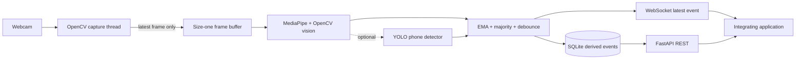

# GazeSignal API

> Privacy-conscious, webcam-based visual session signals over REST and WebSocket.

GazeSignal API는 일반 웹캠 영상을 로컬에서 실시간 처리하여 **거친 시선 방향, 얼굴 존재,
머리 자세, 눈 깜빡임, 선택적 휴대폰 노출**을 구조화된 이벤트로 제공하는 컴퓨터 비전
API입니다. 원본 영상 대신 파생 신호만 FastAPI REST API와 WebSocket으로 전달하므로 기존
웹·데스크톱 애플리케이션에 비전 기능을 별도 서비스처럼 연결할 수 있습니다.

이 프로젝트는 사용자의 집중도, 감정, 정직성, 능력 또는 의도를 추론하지 않습니다.
`looking_away`, `face_missing`, `phone_visible` 같은 값은 센서 관찰 결과이며 사람에 대한 판정이나
자동 의사결정이 아닙니다.

## 프로젝트가 제공하는 것

- 명시적 카메라 동의를 전제로 한 세션 생성·시작·중지·삭제
- MediaPipe 얼굴·눈·홍채 랜드마크 기반 시선 특징 추출
- OpenCV `solvePnP` 기반 yaw·pitch·roll 추정
- `center`, `left`, `right`, `up`, `down`, `away`, `unknown` 시선 구역
- 얼굴 존재, 눈 깜빡임, 분석기 가용성, 신뢰도 및 처리 지연 이벤트
- 5점·9점 화면 캘리브레이션과 개인별 중립 머리 자세 보정
- 선택적 Ultralytics YOLO 휴대폰 감지
- REST 세션 관리, WebSocket 실시간 이벤트, SQLite 세션 요약
- 실제 카메라 영상 위에 결과를 표시하는 로컬 라이브 미리보기
- 카메라 연결 해제, 느린 소비자, 선택 모델 실패를 고려한 런타임 복구

GazeSignal API는 전문 적외선 아이트래커를 대체하지 않습니다. 일반 RGB 웹캠과 얼굴
랜드마크로 **대략적인 화면 구역**을 추정하며, 정밀한 픽셀 좌표나 시선 고정(fixation) 측정값을
보장하지 않습니다.

## 동작 방식



카메라 thread와 분석 thread 사이에는 최신 프레임 하나만 유지합니다. 분석 속도가 카메라보다
느려져도 오래된 프레임과 지연이 계속 쌓이지 않습니다. 분석 결과에는 EMA, 구역 다수결,
debounce, 최소 지속 시간을 적용하여 한 프레임의 흔들림이 즉시 상태 전환이 되는 것을 줄입니다.

원본 프레임은 `Camera → Buffer → Vision` 경로를 벗어나지 않습니다. SQLite, REST,
WebSocket과 로그에는 파생된 숫자와 enum만 전달합니다.

## 사용 기술

| 기술 | 역할 |
|---|---|
| Python 3.11/3.12 | 애플리케이션과 비전 파이프라인 구현 |
| FastAPI · Uvicorn | REST API, WebSocket, OpenAPI 문서, 앱 lifecycle |
| Pydantic Settings | 요청·응답 스키마와 환경 설정 검증 |
| OpenCV | 카메라 획득, 프레임 처리, `solvePnP` 머리 자세 계산 |
| MediaPipe Face Landmarker | 얼굴·눈·홍채 랜드마크 추출 |
| NumPy | 시선 특징, affine 캘리브레이션, 수치 연산 |
| Ultralytics YOLO11n | 선택적 휴대폰 탐지; 기본 설치에서는 비활성화 |
| SQLAlchemy · SQLite | 세션, 파생 이벤트, 상태 전환, 캘리브레이션 저장 |
| SQLite WAL | 분석 쓰기와 API 읽기의 경합 완화 |
| Pytest | 수학, 상태 머신, API, WebSocket, DB 동시성 테스트 |
| Ruff | lint와 코드 포맷 검사 |

### 시선 추정

MediaPipe가 반환한 홍채 중심과 눈 모서리의 상대 비율을 좌우 눈에서 계산합니다. 원본 카메라와
화면 좌표의 좌우 방향 차이를 보정한 뒤, 캘리브레이션이 있으면 다음 affine 변환으로 화면의
정규화 좌표를 추정합니다.

```text
screen_x = a0 + a1 * feature_x + a2 * feature_y
screen_y = b0 + b1 * feature_x + b2 * feature_y
```

캘리브레이션 학습은 표본 품질에 따른 weighted least squares를 사용합니다. 캘리브레이션이
없으면 제한된 홍채 비율 모드로 동작하며 confidence를 최대 0.4로 제한합니다. 기본 임계값에서는
이 결과를 확정 상태로 과장하지 않고 `unknown`으로 유지합니다.

### 머리 자세

코끝, 턱, 눈꼬리, 입꼬리 랜드마크와 3D 기준 얼굴점을 `cv2.solvePnP`에 입력하여 회전 벡터를
구하고 yaw·pitch·roll로 변환합니다. 중앙 캘리브레이션에서 얻은 개인별 중립 자세를 영점으로
사용하므로 노트북 카메라 위치와 자연스러운 앉은 자세의 편향을 줄일 수 있습니다.

### 시간축 상태

한 프레임의 시선 구역을 곧바로 세션 상태로 사용하지 않습니다.

```text
frame signals
  → exponential moving average
  → recent-zone majority vote
  → confidence gate
  → debounce / minimum duration
  → screen_facing | looking_away | face_missing | unknown
```

이 상태는 관찰 결과를 시간축으로 안정화한 값일 뿐 집중도나 행동 의도를 의미하지 않습니다.

## 활용 분야와 통합 방법

GazeSignal API는 판정 엔진보다 **시각 입력을 구조화된 이벤트로 바꾸는 기반 계층**에 가깝습니다.
REST로 lifecycle과 누적 결과를 관리하고 WebSocket으로 최신 이벤트를 구독할 수 있어 다음과
같은 분야에 연결할 수 있습니다.

### HCI·사용성 연구

- 화면 레이아웃별 대략적인 시선 구역 변화 기록
- UI 요소 배치 실험에서 정규화 좌표와 head pose를 시간축 데이터로 결합
- 사용자가 동의한 연구 세션에서 별도 분석 도구로 JSON/CSV 내보내기

정밀 시선 고정점 연구가 필요하면 전문 아이트래커 adapter를 추가하고 동일한 이벤트 스키마를
유지하는 방식으로 확장할 수 있습니다.

### 화상 협업과 발표 보조

- 카메라 방향과 화면 방향의 차이를 로컬 피드백 UI로 표시
- 얼굴이 프레임 밖으로 벗어난 상태나 카메라 구도 변화를 사용자 본인에게 안내
- 영상 자체를 중앙 서버로 추가 전송하지 않고 클라이언트에서 파생 신호만 활용

### 접근성·비접촉 인터랙션 실험

- 좌·우·상·하 구역을 큰 UI 탐색 명령으로 매핑하는 프로토타입
- head pose와 시선 구역을 결합한 hands-free 인터페이스 연구
- 사용자별 5점·9점 캘리브레이션을 이용한 장치 적응

현재 구현은 의료기기나 접근성 보조기기의 안전성 요구사항을 충족한다고 주장하지 않으며,
실사용 전 별도의 정확도·실패 안전성 검증이 필요합니다.

### 온라인 평가·구조화된 원격 세션

- 세션 중 얼굴 존재 여부와 센서 가용성을 운영 상태로 표시
- 시선 이탈이나 장치 노출 이벤트를 타임라인의 검토 가능한 맥락으로 제공
- 단일 이벤트를 규정 위반으로 변환하지 않고 원인 확인이 가능한 관찰 자료로 유지

점수화, 자동 제재, 의도 추론은 이 API의 범위가 아닙니다. 통합 애플리케이션도 사전 고지,
접근성 예외, 데이터 삭제와 사람의 맥락 검토를 제공해야 합니다.

### 인터랙티브 키오스크·전시·미디어

- 사용자가 카메라 기반 상호작용에 동의한 공간에서 얼굴 존재 상태로 UI 활성화
- 대략적인 방향 신호에 따라 콘텐츠 영역을 전환하는 실험
- 얼굴 인식이나 신원 식별 없이 세션 단위 상호작용 구현

## 확장 구조

각 계층은 공개 스키마를 중심으로 분리되어 있습니다.

```text
src/gaze_signal_api/
├── api/           REST/WebSocket, 오류 매핑, app lifecycle
├── capture/       카메라 획득, 장치 probe, size-one buffer
├── vision/        landmark, gaze, head pose, object detector adapter
├── analytics/     smoothing, state machine, session summary
├── calibration/   weighted affine fit/apply
├── runtime/       capture/analysis thread와 lifecycle
├── storage/       SQLAlchemy model, database, repository
├── schemas/       Pydantic 공개/domain contract
├── config/        환경 설정과 validation
└── static/        로컬 calibration console
```

확장 가능한 방향은 다음과 같습니다.

- `Capture` 경계에 RTSP, 브라우저 WebRTC, 가상 카메라 adapter 추가
- MediaPipe 대신 다른 landmark·gaze model을 `FrameSignals` 계약 뒤에 연결
- 전문 아이트래커 입력을 같은 정규화 좌표와 품질 필드로 변환
- phone detector를 다른 객체 감지 모델이나 조직별 detector로 교체
- SQLite repository를 PostgreSQL·시계열 저장소 adapter로 교체
- 프로세스 내부 EventHub를 Redis Streams, NATS, Kafka 등으로 교체
- API gateway에서 인증, TLS, rate limit, tenant isolation 추가
- OpenTelemetry metrics와 구조화된 운영 관측성 추가
- 보존 기간, 집계, 익명화, 사용자 export 정책 추가
- 캘리브레이션 drift 감지와 장치별 품질 평가 자동화

현재 기본 구성은 한 컴퓨터에서 한 카메라를 처리하는 로컬 MVP입니다. 원격·다중 사용자 환경에
배포하려면 인증, 암호화, tenant 격리, 보존 정책과 동의 증빙을 먼저 설계해야 합니다.

## 빠른 시작

Python 3.11 또는 3.12를 사용합니다. macOS에서는 명령을 실행하는 Terminal이나 Python
실행기에 카메라 권한이 필요합니다.

```bash
git clone https://github.com/100bee/gaze-signal-api.git
cd gaze-signal-api

python3.12 -m venv .venv
source .venv/bin/activate
pip install -e '.[dev,vision]'
python scripts/download_models.py
cp .env.example .env
gaze-signal-api
```

기본 주소:

- 로컬 콘솔: <http://127.0.0.1:8000>
- OpenAPI/Swagger UI: <http://127.0.0.1:8000/docs>
- 상태 확인: <http://127.0.0.1:8000/health>

서버는 기본적으로 `127.0.0.1`에만 바인딩합니다. 다른 origin을 연결하려면 `.env`의
`GAZE_SIGNAL_ALLOWED_ORIGINS`를 설정합니다. localhost 외부에 공개하기 전에는 이 저장소의
MVP에 포함되지 않은 인증, TLS와 rate limit을 추가해야 합니다.

### macOS 라이브 미리보기

실제 카메라 영상 위에 시선 구역, 추정 위치, 얼굴 상태와 head pose를 표시합니다.

```bash
python -m gaze_signal_api.preview --consent --camera 0
```

MacBook 내장 카메라가 1번으로 잡히는 환경에서는 다음과 같이 실행합니다.

```bash
python -m gaze_signal_api.preview --consent --camera 1
```

`Q` 또는 `Esc`로 종료하고 `M`으로 미러 표시를 전환합니다. 이 창은 로컬 디버깅 도구이며
영상을 저장하거나 API로 전송하지 않습니다. 저장된 캘리브레이션을 적용하려면 다음을 사용합니다.

```bash
python -m gaze_signal_api.preview --consent --camera 1 --calibration-id latest
```

## API 사용 예

먼저 통합 UI에서 카메라 처리 목적과 데이터 정책을 알리고 동의를 받은 뒤 세션을 생성합니다.

```bash
curl -s http://127.0.0.1:8000/sessions \
  -H 'content-type: application/json' \
  -d '{
    "consent_given": true,
    "camera_index": 0,
    "frame_width": 640,
    "frame_height": 480,
    "target_fps": 15,
    "yolo_enabled": false
  }'
```

응답의 `id`로 세션을 제어합니다.

```bash
curl -X POST http://127.0.0.1:8000/sessions/SESSION_ID/start
curl http://127.0.0.1:8000/sessions/SESSION_ID/events?limit=100\&offset=0
curl -X POST http://127.0.0.1:8000/sessions/SESSION_ID/stop
curl http://127.0.0.1:8000/sessions/SESSION_ID/summary
```

실시간 이벤트는 다음 WebSocket에서 받습니다.

```text
ws://127.0.0.1:8000/ws/sessions/SESSION_ID
```

예시 이벤트:

```json
{
  "session_id": "8bf3de9a-f0d8-45c2-a719-07bcb8962fb4",
  "timestamp": "2026-09-04T01:23:45.123Z",
  "face_present": true,
  "face_analysis_available": true,
  "gaze_zone": "center",
  "gaze_feature_x": 0.51,
  "gaze_feature_y": 0.48,
  "head_yaw": -4.2,
  "head_pitch": 7.1,
  "head_roll": 0.8,
  "blink_detected": false,
  "phone_visible": false,
  "state": "screen_facing",
  "confidence": 0.87,
  "processing_latency_ms": 8.4
}
```

`confidence`는 통계적으로 보정된 정확도 확률이 아니라 모델 가용성, 특징 품질과 캘리브레이션
오차를 조합한 휴리스틱 품질 게이트입니다.

더 많은 요청·응답 예시는 [API 예시](docs/api_examples.md)를 참고하세요.

## 선택적 휴대폰 감지

```bash
pip install -e '.[yolo]'
python scripts/download_models.py --include-yolo
GAZE_SIGNAL_YOLO_ENABLED=true gaze-signal-api
```

Ultralytics는 AGPL-3.0 또는 상용 라이선스를 제공합니다. 배포 형태에 맞는 라이선스를 반드시
검토해야 합니다. YOLO weight가 없거나 초기화에 실패해도 얼굴·시선 분석은 계속되도록 격리되어
있습니다. 자세한 내용은 [제3자 고지](THIRD_PARTY_NOTICES.md)에 있습니다.

## 개인정보 보호 경계

- 원본 프레임, 얼굴 crop, landmark overlay를 저장하거나 API로 전송하지 않습니다.
- 얼굴 embedding, 얼굴 인식, 신원 식별과 감정 추론을 구현하지 않습니다.
- 오디오, 화면 내용, 키 입력, 클립보드와 창 제목을 수집하지 않습니다.
- 카메라 시작과 장치 probe에는 명시적인 동의가 필요합니다.
- 세션과 캘리브레이션 삭제 API를 제공합니다.
- `GAZE_SIGNAL_STORE_RAW_FRAMES=true`는 설정 validation에서 거부됩니다.
- 상태와 confidence를 사람에 대한 점수·순위·자동 제재에 사용하도록 설계하지 않았습니다.

SQLite에 저장되는 파생 특징도 개인 관련 데이터로 취급해야 합니다. 실제 배포자는 짧은 보존
기간, 접근 제어, 삭제·export 흐름, 동의 철회와 관할 법률 검토를 추가해야 합니다.

자세한 데이터 흐름과 위협 모델은 [개인정보·윤리 경계](docs/privacy.md)에 있습니다.

## 테스트와 검증

```bash
.venv/bin/pytest
.venv/bin/ruff check .
.venv/bin/ruff format --check .
python scripts/evaluate_zones.py examples/evaluation_sample.csv
```

자동 테스트는 시선 구역, head-pose 변환, affine calibration, EMA, debounce, 상태 전환,
세션 요약, 요청 validation, CRUD, WebSocket, SQLite 동시 쓰기와 카메라 실패를 검사합니다.

실제 MacBook 카메라에서는 640×480 입력으로 MediaPipe Face Landmarker의 end-to-end 동작과
로컬 프레임 처리를 확인했습니다. 해당 실행은 동작 확인용 smoke test이며 다양한 사용자·조명·안경·
장치 조건의 정확도를 의미하지 않습니다. 재현 명령과 남은 검증 항목은
[실기기 검증 기록](docs/hardware-validation.md)에 있습니다.

## 알려진 한계

- 강한 안경 반사, 얼굴 가림, 저조도, 역광과 모션 블러에 민감합니다.
- 카메라 각도와 화면 배치가 바뀌면 다시 캘리브레이션해야 합니다.
- 전문 아이트래커 수준의 시선 정확도와 sampling rate를 제공하지 않습니다.
- YOLO 휴대폰 감지는 선택 기능이며 실물·가림 조건별 추가 평가가 필요합니다.
- 기본 서버에는 원격 배포용 사용자 인증과 tenant isolation이 없습니다.
- 현재 `confidence`는 확률 보정된 모델 신뢰도가 아닙니다.

불확실한 조건에서는 억지로 방향을 결정하기보다 낮은 confidence, `unknown`,
`face_missing` 또는 명시적인 기능 저하 상태를 반환합니다.

## 문서

- [아키텍처](docs/architecture.md)
- [API 예시](docs/api_examples.md)
- [요구사항과 범위](docs/requirements.md)
- [평가 프로토콜](docs/evaluation.md)
- [실기기 검증 기록](docs/hardware-validation.md)
- [개인정보·윤리 경계](docs/privacy.md)
- [제3자 라이선스 고지](THIRD_PARTY_NOTICES.md)

## 라이선스

프로젝트의 자체 코드는 [MIT License](LICENSE)로 제공됩니다. MediaPipe, OpenCV 및 선택적
Ultralytics를 포함한 제3자 구성요소와 모델 weight에는 각각의 라이선스가 적용됩니다.
