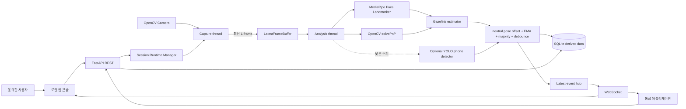
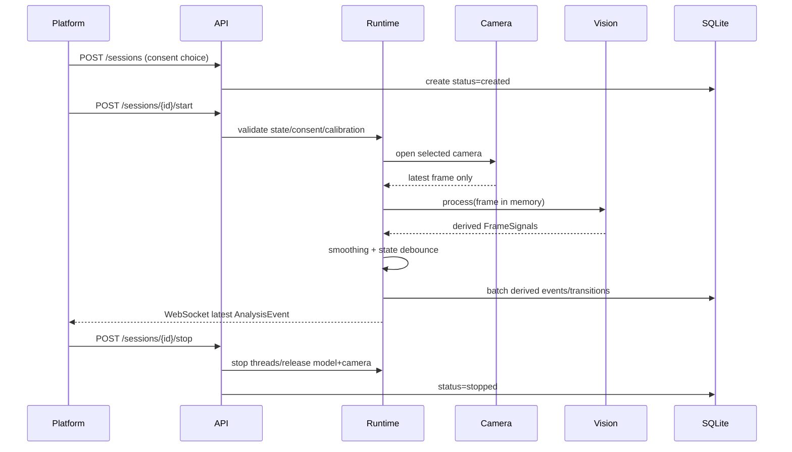

# 아키텍처

## 설계 요약

MVP는 배포가 단순한 로컬 단일 애플리케이션이다. 프로세스는 하나지만 프레임 획득, 단일 프레임 비전, 시간축 분석, 영속화, API 경계를 분리했다. 비전 모델 객체는 라우터나 ORM을 알지 못한다.



원본 프레임은 Camera → Buffer → Worker 경로 밖으로 나가지 않는다. DB·REST·WebSocket에는 파생된 숫자와 enum만 전달한다.

## 패키지 경계

```text
src/gaze_signal_api/
├── api/           HTTP/WebSocket, 오류 매핑, 앱 lifespan
├── capture/       OpenCV 획득, 장치 probe, size-one buffer
├── vision/        frame-local landmarks/pose/gaze/object adapters
├── analytics/     smoothing, state machine, summary integration
├── calibration/   weighted affine fit/apply
├── runtime/       capture/analysis threads, fan-out, lifecycle
├── storage/       SQLAlchemy models/database/repository
├── schemas/       Pydantic public/domain contracts
├── config/        environment settings and validation
└── static/        optional local console
```

의존 방향은 API/runtime → domain schemas/services → storage/vision adapter다. `capture`는 frame 내용의 의미를 모르며, `vision`은 DB/HTTP를 모르고, `analytics`는 카메라 라이브러리를 import하지 않는다.

## 런타임 시퀀스



## Backpressure와 성능

카메라 thread가 `LatestFrameBuffer(maxsize=1)`에 넣을 때 기존 항목이 있으면 버린다. analysis가 느려져도 메모리와 지연이 누적되지 않는다. `target_fps`는 처리 상한이며 YOLO는 `every_n_frames`마다만 실행하고 중간에는 마지막 관찰을 유지한다. SQLite insert는 작은 batch로 수행하고 파일 DB는 WAL·busy timeout을 사용해 API read와 분석 write의 경합을 줄인다.

WebSocket subscriber queue도 한 이벤트만 유지한다. 느린 클라이언트는 오래된 이벤트보다 최신 상태를 받는다. 전체 기록은 SQLite에 남으므로 페이지 API에서 조회할 수 있다.

## 기능 저하와 오류 경계

- OpenCV/카메라 시작 실패: start 요청을 503 처리하고 세션을 `failed`로 기록한다.
- MediaPipe/model/GPU service 미가용: 로딩 실패를 기억해 반복 초기화하지 않고, 세션은 계속되며 `face_analysis_available=false`, state `unknown`이다.
- YOLO 실패: detector만 비활성화하고 face/gaze는 계속된다.
- 연결 해제: 제한 횟수만 재연결 후 안전한 failure code로 세션을 종료한다.
- 내부 exception: 구조화 로그에는 기록하되 API 응답에는 경로/traceback을 내보내지 않는다.

## 데이터 모델

- `sessions`: 동의 사실, 카메라/화면 geometry, 상태, 시작/중지, 안전한 failure code
- `analysis_events`: 요구된 파생 신호와 calibration용 eye feature
- `state_transitions`: debounce가 확정한 from/to state
- `calibrations`: geometry, affine 계수, 중앙 표적의 중립 head-pose offset, RMSE, sample count. 원본 프레임 없음

세션 삭제는 analysis/transition 행을 cascade 삭제한다. 캘리브레이션 삭제 시 기존 세션의 참조는 `NULL`이 되지만 이미 저장된 파생 이벤트는 유지된다.

## 확장 지점

- `Capture` protocol로 파일/가상 카메라 test adapter 추가
- Face Landmarker를 LIVE_STREAM mode로 바꾸되 동일 FrameSignals 유지
- SQLite event retention/aggregation 정책
- head-pose feature까지 포함하는 calibration v2와 drift 감지
- 다중 프로세스가 필요할 때 EventHub/runner를 별도 로컬 service로 이동
